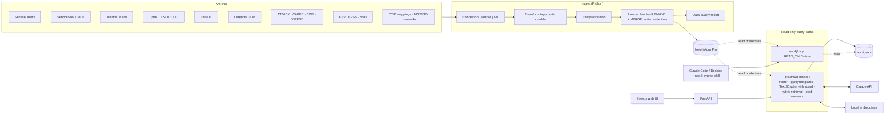
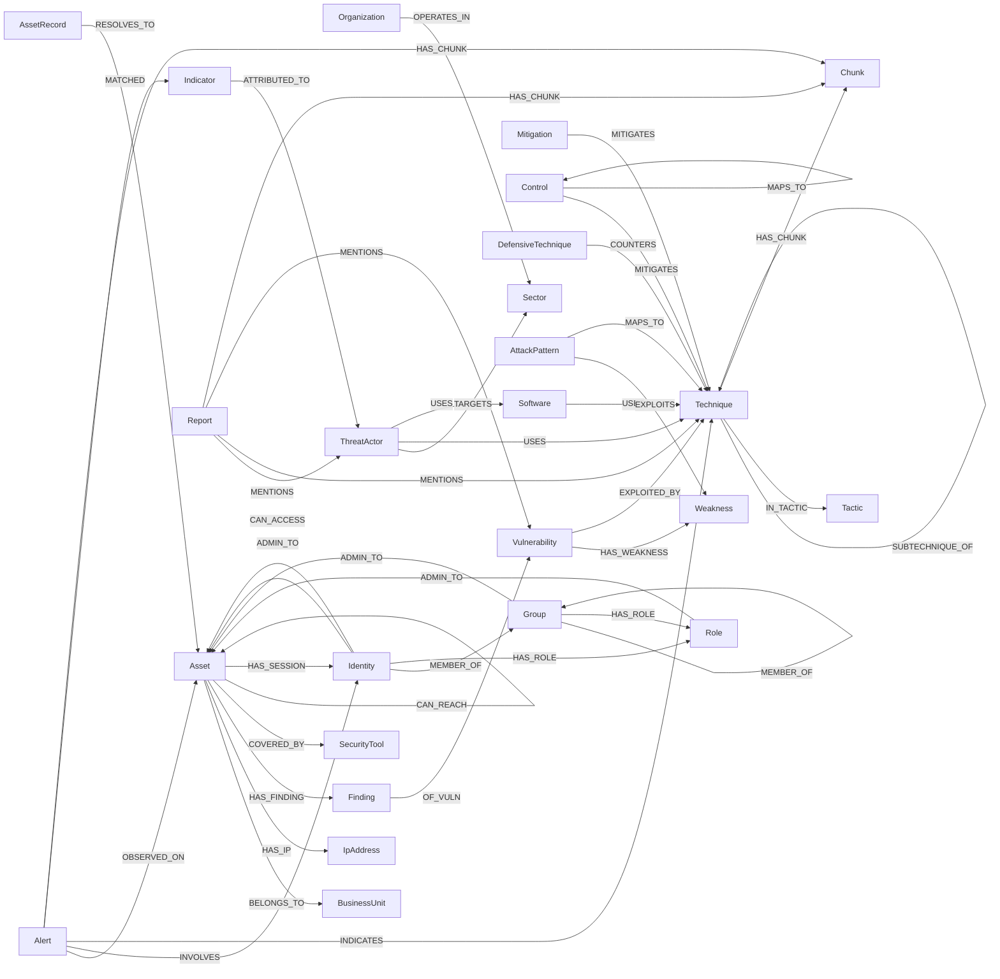

# Security GraphRAG on Neo4j Aura — Plan

Status: **draft, awaiting approval**. No code has been written yet.

## 1. Decisions so far

| Topic | Decision |
|---|---|
| Source products (shapes synthetic data now, real connectors later) | SIEM: Microsoft Sentinel · CMDB: ServiceNow · Vuln: Tenable · CTI: OpenCTI (STIX 2.1 / TAXII 2.1) · Identity: Entra ID · EDR: Defender for Endpoint · CSPM: Wiz · EASM: none |
| Data | Synthetic first. Financial-services org, ~3,000 assets, 6 business units, 5 crown jewels, ~1,500 identities |
| Database | Aura **Professional** for the shared graph; local Neo4j in podman for development and tests |
| LLM | Claude (`claude-sonnet-5-5` default, configurable) for routing, Cypher generation and answers |
| Embeddings | Local `sentence-transformers` (default `BAAI/bge-small-en-v1.5`, 384 dims); Voyage as a config switch |
| Users | You plus a few SOC analysts; occasional executive demos |
| Data handling | Synthetic only for now; runs locally; a classification review is a hard gate before any real data (§10) |
| Control frameworks | Control IDs and short titles only (no ISO text); mappings via CTID and NIST crosswalks; ISO 42001 included but kept light |
| Repo | `git init` done (branch `main`, no commits); Claude Desktop on Linux |
| Python | 3.13 (pinned with uv). `neo4j-graphrag` 1.22.0 supports up to 3.14; driver `neo4j` 6.4.1 |

### Finding that changes the brief: Aura Professional has no RBAC

Neo4j's pricing page marks **"RBAC and Fine-Grained Access Control: Not Included"** for Free and Professional, and **Included** for Business Critical and Virtual Dedicated Cloud. So on Professional there is one database user, and it can write. A true read-only user, as the brief asks, isn't possible on this tier.

Proposal: build for two sets of credentials from day one (`NEO4J_WRITE_*` for ingest, `NEO4J_READ_*` for queries). On Professional both point at the same user, and read-only is enforced by four layers (§7.3). Before any real data is loaded, decide between:

- **(a) Accept the layered controls on Professional.** Fine for synthetic data.
- **(b) Move to Business Critical.** Minimum 2 GB at $0.20/GB/hour, roughly $290/month. Gives a real read-only user and an audit trail in the database itself.
- **(c) Use local Neo4j Enterprise** (evaluation licence, development only) to demonstrate the RBAC design without paying for Business Critical.

Recommendation: (a) now, with (b) as a condition for real data.

## 2. Environment (checked 2026-10-27)

- **Skills installed:** `neo4j-cypher-skill`, `neo4j-modeling-skill`, `neo4j-graphrag-skill`, `neo4j-document-import-skill`, `neo4j-driver-python-skill`. The Cypher skill is present and is used for all Cypher in this plan and later.
  - Suggested additions from the same repo, pending your approval: `neo4j-mcp-skill` (phase 2), `neo4j-security-skill` (RBAC, if we go to Business Critical), and `neo4j-vector-index-skill` (the GraphRAG skill hands hybrid-index work to it).
- **MCP:** no Neo4j MCP server configured. The target is the official `neo4j/mcp` server (v1.6.1, released 2026-10-21; PyPI `neo4j-mcp-server`). Its tools are `get-schema`, `read-cypher`, `write-cypher` and `list-gds-procedures`. Setting `NEO4J_READ_ONLY=true` disables `write-cypher`.
- **Tooling:** uv 0.12, Python 3.14 on the system (project pins 3.13), Node 20, podman 5.8, git, gh. No `cypher-shell`; it isn't needed, because the driver, MCP and Query API cover everything.

## 3. Data sources: what to include, and why

| Source | Verdict | Why it earns its place | Phase |
|---|---|---|---|
| SIEM alerts (Sentinel) | **Required** | Observed activity: alert → asset, identity, technique. Drives "what is happening" and the heatmap's "observed" axis | 1 (synthetic) |
| CMDB (ServiceNow) | **Required** | Asset identity, owner, business unit, criticality, crown jewels | 1 (synthetic) |
| Vulnerability scans (Tenable) | **Required** | Findings on assets; the backbone of exposure | 1 (synthetic) |
| CTI (OpenCTI, as STIX 2.1) | **Required** | Actors, sector targeting, reports (text for vector search), indicators | 1 (synthetic) |
| MITRE ATT&CK, Enterprise STIX | **Required** | Techniques, tactics, groups, software, mitigations. "Cloud" isn't a separate bundle: the IaaS, SaaS, Office Suite and Identity Provider platforms are inside Enterprise | 1 (fixture), 4 (live) |
| CISA KEV | **Include** | Turns "a CVE" into "a CVE being exploited now"; adds due dates and ransomware use | 1 (fixture), 4 |
| FIRST EPSS | **Include** | Exploit likelihood for prioritisation and risk scoring; daily deltas feed "what changed" | 1 (fixture), 4 |
| NVD / CVE | **Include, subset only** | CVSS, CWE and descriptions, only for CVEs found on our assets plus all KEV entries, not all ~300k CVEs | 4 |
| CWE + CAPEC | **Include** | The CVE → weakness → attack pattern → technique chain links vulnerabilities to ATT&CK where no direct mapping exists. Marked as inferred, lower confidence | 4 |
| **CTID Mappings Explorer** (not in your list) | **Include, essential** | The published mappings: KEV CVE → ATT&CK, and NIST 800-53 → ATT&CK. Without them, "which controls mitigate" and "vulnerability → technique" are guesswork | 4 |
| MITRE D3FEND | **Include** | Defensive techniques that counter ATT&CK techniques. Lets us show the gap between what could defend and what we have deployed | 4 |
| Identity (Entra ID): users, groups, roles, service principals | **Include, high value** | Without it there are no attack paths. Phished user → session → admin rights → crown jewel is an identity graph | 1 (synthetic) |
| EDR coverage (Defender) | **Include, high value** | Required for "KEV vulnerabilities on assets with no EDR"; last check-in separates "installed" from "working" | 1 (synthetic) |
| Network reachability | **Include, minimal** | Asset → asset reachability (port and protocol) for lateral-movement paths. Synthetic at the segment level | 1 (synthetic) |
| CSPM (Wiz) | **Defer** | Useful (cloud misconfigurations as findings) but doesn't serve the four core questions. Fits the same `:Finding` pattern later | after 5 |
| External attack surface | **Defer** | You have no EASM product. The `:InternetFacing` label comes from the CMDB and firewall data in synthetic mode | after 5 |
| NIST CSF 2.0 + SP 800-53 | **Include** | 800-53 is the hub: CTID maps it to ATT&CK, and NIST's official crosswalks map it to CSF 2.0 and ISO 27001 | 4 |
| ISO 27001:2022 Annex A | **Include, IDs and titles** | Reached through the NIST 800-53 ↔ ISO 27001 crosswalk. No licensed text | 4 |
| ISO 42001 | **Light** | Applies to AI systems, which ATT&CK barely covers. The better partner is **MITRE ATLAS**; recommended as an optional later source | after 5 |
| STIX 2.1 / TAXII 2.1 | **Adopt as the CTI format** | ATT&CK, CAPEC and OpenCTI all speak STIX, so one STIX reader serves them all. TAXII is the transport for the real OpenCTI connector | 1 onwards |

## 4. Architecture



## 5. Graph data model

This follows `neo4j-modeling-skill`:
- labels are PascalCase, relationship types are SCREAMING_SNAKE_CASE, properties are camelCase (so `firstSeen`, not `first_seen`);
- there are no generic types such as `:Entity` or `:RELATED_TO`;
- low-cardinality categories that queries filter on are labels;
- embeddings live on `:Chunk` nodes, not on business nodes.

### 5.1 Overview



### 5.2 Nodes

Every node carries the provenance properties in §5.4. Labels after the colon are extra labels for filtering.

| Label (+ extra labels) | Key (unique) | Main properties |
|---|---|---|
| `Asset` (`:InternetFacing`, `:CrownJewel`, `:Unmanaged`) | `assetId` | `hostname`, `fqdn`, `assetType`, `os`, `criticality` (1–5), `owner`, `riskScore` (derived) |
| `AssetRecord` | `recordKey` (`source:sourceId`) | Raw identifiers as each source reports them: `hostname`, `ip`, `mac`, `serial`, `cloudInstanceId` |
| `IpAddress` (`:Public`) | `address` | `version` |
| `BusinessUnit` | `buId` | `name` |
| `Organization` / `Sector` | `orgId` / `name` | |
| `Identity` (`:User`, `:ServicePrincipal`, `:Privileged`) | `identityId` | `upn`, `displayName`, `enabled`, `mfaEnabled` |
| `Group` / `Role` (`:Privileged`) | `groupId` / `roleId` | `name` |
| `Finding` | `findingId` | `status` (open, fixed, accepted), `severity`, `port`, `pluginId`, `fixedAt` |
| `Vulnerability` (`:KEV`) | `cveId` | `cvssScore`, `cvssVector`, `published`, `epssScore`, `epssPercentile`, `epssDate`, `kevDateAdded`, `kevDueDate`, `kevRansomware` |
| `Weakness` / `AttackPattern` | `cweId` / `capecId` | `name` |
| `Technique` (`:SubTechnique`) | `techniqueId` (e.g. `T1566.001`) | `name`, `platforms`, `stixId`, `attackVersion` |
| `Tactic` | `tacticId` | `name`, `shortName`, `matrixOrder` |
| `ThreatActor` | `actorId` (ATT&CK `G…` or CTI id) | `name`, `aliases`, `aliasText` (for full-text search) |
| `Software` | `softwareId` | `name`, `softwareType` (malware or tool) |
| `Mitigation` | `mitigationId` (`M…`) | `name` |
| `DefensiveTechnique` | `d3fendId` | `name` |
| `Control` | `controlId` (e.g. `ISO27001:A.8.7`, `NIST80053:SI-3`) | `framework`, `title`, `implementationStatus` |
| `SecurityTool` | `toolId` | `name`, `category` (EDR, SIEM…) |
| `Alert` | `alertId` | `title`, `severity`, `status`, `createdAt` |
| `Report` | `reportId` | `title`, `published`, `tlp` |
| `Indicator` | `indicatorId` | `indicatorType`, `value`, `pattern` |
| `Chunk` | `chunkId` | `text`, `embedding`, `chunkIndex`, `kind` (cti, technique, alert), `suspicious` |
| `IngestRun` | `runId` | `source`, `mode`, `startedAt`, `finishedAt`, `counts`, `watermark` |
| `ExposureSnapshot` | `snapshotId` | `takenAt`, weekly metrics (for trends and the time scrubber) |

**Why `Finding` is a node and not a `HAS_VULN` relationship.** A finding has its own lifecycle: status, first seen, fixed date, port, scanner plugin. "What changed" queries ask about findings directly. Per the modeling skill, a connection with more than two properties that's queried on its own becomes an intermediate node. The cost is one extra hop: `Asset → Finding → Vulnerability`.

**Attack-path relationships point the way an attacker moves.** Controlling the start of an arrow gives control of its end:
- `Identity -[:MEMBER_OF]-> Group`: control the user and you hold the group's rights.
- `Asset -[:HAS_SESSION]-> Identity`: control the machine and you can steal that identity's credentials.
- `-[:ADMIN_TO]->`, `-[:CAN_ACCESS]->` and `Asset -[:CAN_REACH]-> Asset` work the same way.

Because every arrow points forward, attack paths need only one directed variable-length pattern.

### 5.3 Entity resolution (one host, many names)

This runs in Python before loading. It's deterministic, so reruns give the same result.

1. Keep every source's view as an `AssetRecord` (`recordKey = source:sourceId`). Raw evidence is never thrown away.
2. Normalise: lower-case FQDN, short hostname, MAC with standard separators, cloud instance ID, serial number.
3. Match in strength tiers, joining records with union-find:
   - **Strong, merged automatically:** same cloud instance ID, serial, MAC or FQDN.
   - **Medium, merged:** same short hostname and same business unit, with no conflicting strong identifier.
   - **Weak, not merged:** same IP only. IPs are reused (DHCP, NAT), so these become `POSSIBLY_SAME_AS {score}` candidates and are listed in the data-quality report.
4. Canonical `assetId`: the CMDB `sys_id` if there is one, otherwise a stable hash of the strongest identifier.
5. `AssetRecord -[:RESOLVES_TO {method, confidence}]-> Asset` records how each match was made.
6. Assets seen by the scanner, SIEM or EDR but absent from the CMDB get the `:Unmanaged` label. This is shadow IT, and worth showing in its own right.

### 5.4 Provenance and time, on every node and relationship

| Property | Meaning |
|---|---|
| `source` / `sources` | Primary source, and every source that has asserted it |
| `confidence` | 0–100, STIX style. Direct mappings such as CTID score high; inferred chains (CWE → CAPEC → ATT&CK) score lower |
| `firstSeen` / `lastSeen` | `ZONED DATETIME`, always coerced to the `UTC` zone on write. The Cypher skill flags a trap: a `Z` suffix is stored as an offset, not as UTC, and range queries across the two silently return nothing |
| `lastRunId` | The `IngestRun` that last touched it |

Nothing is deleted. Items that disappear get `lastSeen` frozen, and findings get `status = 'fixed'` with `fixedAt`. That makes questions about the past answerable: an item existed at time *t* if `firstSeen <= t` and (`fixedAt` is null or `fixedAt > t`). This one rule powers both "what changed since last week" and the time scrubber. Synthetic data includes 12 weeks of history so the scrubber has something to show.

### 5.5 Constraints and indexes

- **Constraints:** every key in §5.2 gets a uniqueness constraint (required by the skill before any `MERGE`), plus property-type constraints on scores and dates.
  - If Aura reports version 2026.06 or later (checked in phase 1 with `CALL dbms.components()`), the whole model is declared once with `ALTER CURRENT GRAPH TYPE SET { … }`, as the modeling skill recommends; that version also enforces relationship endpoint types.
  - Otherwise each constraint gets its own `CREATE CONSTRAINT … IF NOT EXISTS`.
  - The local container uses the Enterprise image so it matches Aura.
- **Range indexes:** `Finding.status`, `Finding.firstSeen`, `Finding.fixedAt`, `Alert.createdAt`, `Vulnerability.epssScore`, `Asset.hostname`.
- **Full-text `entity_names`** over `Asset|ThreatActor|Technique|Software|Control|Vulnerability` names, IDs and aliases. Used for entity linking: turning "the payroll server" or "Lazarus" into node IDs before any Cypher is generated.
- **Vector `chunk_embedding`** on `Chunk.embedding` (384 dims, cosine), with `kind` declared as a filter property, plus **full-text `chunk_text`** on `Chunk.text`. Together these give hybrid retrieval.

### 5.6 The four target questions as Cypher

These were drafted with `neo4j-cypher-skill` against the proposed schema. They are **not yet validated**: phase 1 runs `EXPLAIN` and `PROFILE` on each against the synthetic data.

```cypher
// Q1: internet-facing assets exposed to techniques used by actors targeting our sector, plus mitigating controls
CYPHER 25
MATCH (:Organization {orgId: $orgId})-[:OPERATES_IN]->(:Sector)<-[:TARGETS]-(actor:ThreatActor)-[:USES]->(t:Technique)
MATCH (a:Asset:InternetFacing)-[:HAS_FINDING]->(:Finding {status: 'open'})-[:OF_VULN]->(v:Vulnerability)-[:EXPLOITED_BY]->(t)
WITH a, t, collect(DISTINCT actor.name) AS actors, collect(DISTINCT v.cveId) AS cves
RETURN a.assetId AS assetId, a.hostname AS hostname, t.techniqueId AS techniqueId, t.name AS technique,
       actors, cves, size(cves) AS cveCount,
       COLLECT { MATCH (c:Control)-[:MITIGATES]->(t) RETURN {id: c.controlId, status: c.implementationStatus} } AS controls
ORDER BY cveCount DESC
LIMIT 25
```

```cypher
// Q2: attack paths from phished users to crown jewels
CYPHER 25
MATCH (alert:Alert)-[:INDICATES]->(t:Technique)
WHERE t.techniqueId IN $phishingTechniqueIds          // ['T1566', 'T1566.001', 'T1566.002', ...]
MATCH (alert)-[:INVOLVES]->(u:Identity:User)
WITH DISTINCT u LIMIT 25
MATCH p = SHORTEST 3 (u)(()-[:MEMBER_OF|HAS_ROLE|ADMIN_TO|CAN_ACCESS|HAS_SESSION|CAN_REACH]->()){1,8}(cj:Asset:CrownJewel)
RETURN u.upn AS entryUser, cj.hostname AS crownJewel, length(p) AS hops,
       [n IN nodes(p) | elementId(n)] AS pathNodeIds,
       [r IN relationships(p) | type(r)] AS pathRelTypes
ORDER BY hops
LIMIT 25
```

```cypher
// Q3: KEV vulnerabilities on assets with no working EDR (no check-in for 7 days counts as none)
CYPHER 25
MATCH (a:Asset)-[:HAS_FINDING]->(:Finding {status: 'open'})-[:OF_VULN]->(v:Vulnerability:KEV)
WHERE NOT EXISTS {
  MATCH (a)-[c:COVERED_BY]->(:SecurityTool {category: 'EDR'})
  WHERE c.lastCheckIn >= $now - duration('P7D')
}
RETURN v.cveId AS cveId, v.kevDueDate AS kevDueDate, v.epssScore AS epss,
       a.assetId AS assetId, a.hostname AS hostname, a:InternetFacing AS internetFacing
ORDER BY epss DESC
LIMIT 25
```

```cypher
// Q4: what changed in our exposure since $since
CYPHER 25
CALL () {
  MATCH (a:Asset)-[:HAS_FINDING]->(f:Finding)-[:OF_VULN]->(v:Vulnerability)
  WHERE f.firstSeen >= $since
  RETURN 'new finding' AS change, a.assetId AS assetId, v.cveId AS detail, f.firstSeen AS at
  UNION ALL
  MATCH (a:Asset)-[:HAS_FINDING]->(f:Finding)-[:OF_VULN]->(v:Vulnerability)
  WHERE f.fixedAt >= $since
  RETURN 'fixed' AS change, a.assetId AS assetId, v.cveId AS detail, f.fixedAt AS at
  UNION ALL
  MATCH (a:Asset)-[:HAS_FINDING]->(:Finding {status: 'open'})-[:OF_VULN]->(v:Vulnerability:KEV)
  WHERE v.kevDateAdded >= date($since)
  RETURN 'newly KEV-listed' AS change, a.assetId AS assetId, v.cveId AS detail, datetime(v.kevDateAdded) AS at
  UNION ALL
  MATCH (a:Asset:InternetFacing)
  WHERE a.firstSeen >= $since
  RETURN 'new internet-facing asset' AS change, a.assetId AS assetId, a.hostname AS detail, a.firstSeen AS at
}
RETURN change, assetId, detail, at
ORDER BY at DESC
LIMIT 100
```

Q2 is the performance risk. The variable-length search fans out through `CAN_REACH` and `MEMBER_OF`. Phase 1 profiles it, and if needed caps the hops or splits reachability by network segment.

### 5.7 Derived risk score

`Asset.riskScore` (0–100) is recomputed after each load. It combines:
- criticality;
- whether the asset is internet-facing;
- the worst open finding, measured as CVSS × (0.5 + EPSS), multiplied by 1.5 if KEV-listed;
- no working EDR;
- alerts in the last 7 days;
- whether it's a crown jewel.

This is a documented, tunable heuristic for ranking and for the visuals. It isn't a substitute for your organisation's risk methodology.

## 6. Data pipeline

- **One interface per source:**
  - `Connector.extract(mode, since) -> records`
  - `transform(records) -> NodeBatch / RelBatch` (pydantic models)
  - `mode` is `sample` (seeded, offline, no credentials) or `live`.
- **Synthetic data is built around a story.** It's seeded, so it's identical on every run, and it's planted so the four questions have interesting answers:
  - a financial-sector actor using T1190 against an internet-facing VPN appliance with a KEV-listed CVE and no EDR;
  - a phished user whose workstation also holds a Domain Admin session, giving a path to a crown jewel;
  - last week's changes: new findings, fixes, and a new KEV listing.

  Synthetic findings use **real CVE IDs**, so when phase 4 brings in live KEV and EPSS, they join with the synthetic assets. Record shapes mirror the real exports: ServiceNow `cmdb_ci`, Tenable vulnerability export, Sentinel `SecurityAlert`, Defender device inventory, Microsoft Graph users, groups and role assignments, and OpenCTI STIX bundles.
- **Public feeds in phases 1–3** use small committed fixture snapshots (a trimmed ATT&CK bundle, KEV and EPSS subsets), so everything runs offline. Phase 4 swaps in the live feeds.
- **Idempotent loads:**
  - one Cypher template per model class with static labels (never labels taken from data);
  - batches via `UNWIND $rows … MERGE` on the constrained key, about 1,000 rows per managed transaction;
  - relationship `MERGE` only between endpoints that are already matched;
  - `ON CREATE` sets `firstSeen`; `ON MATCH` updates `lastSeen` and adds to `sources`.
- **Incremental updates:** each source keeps a watermark on its `IngestRun`.
  - KEV and EPSS: daily.
  - ATT&CK: when a new release is published.
  - NVD: deltas by last-modified date.
  - Scheduling is plain `uv run threadline refresh` from cron or a systemd timer. No orchestration framework.
- **Data-quality report after every load** (Markdown and JSON in `reports/`):
  - counts per label and relationship type, compared with the previous run;
  - orphans (findings without an asset);
  - missing required properties;
  - entity-resolution stats (merged, unmanaged, possible duplicates);
  - stale records;
  - chunks flagged as suspicious (§10).

  The run exits non-zero if a guard trips, for example a count dropping by more than 30%.
- **Libraries:** `neo4j`, `neo4j-graphrag[anthropic]`, `pydantic`, `pydantic-settings` (`.env`), `sentence-transformers`, `httpx`, and later `fastapi` and `uvicorn`. Development: `pytest`, `ruff`. The local-embeddings choice pulls in PyTorch (a large download); the plan uses the CPU-only build.

## 7. Natural-language querying

### 7.1 MCP path (Claude Code and Claude Desktop)

A wrapper script reads `.env` and starts the server with the **read** credentials and `NEO4J_READ_ONLY=true`, so no secrets appear in any MCP config. Draft commands (exact binary path and flags are confirmed in phase 2):

```bash
uv tool install neo4j-mcp-server                      # official neo4j/mcp
claude mcp add neo4j-threadline --scope project -- /home/mythos/Projects/neo4j/scripts/neo4j-mcp-readonly.sh
```

Claude Desktop (`~/.config/Claude/claude_desktop_config.json` on Linux; path to be confirmed):

```json
{ "mcpServers": { "neo4j-threadline": { "command": "/home/mythos/Projects/neo4j/scripts/neo4j-mcp-readonly.sh" } } }
```

In Claude Code, a small project skill `.claude/skills/query-security-graph` makes the flow consistent:
1. Read the committed schema file (`threadline-schema.json`, generated by the Cypher skill's `generate_schema.py`). This is the Cypher skill's preferred schema source.
2. Write the query with `neo4j-cypher-skill`.
3. **Show the Cypher.**
4. Run it through `read-cypher`.
5. Return results with node IDs.

A `PreToolUse` hook on the MCP Cypher tools appends each query to `logs/audit.jsonl`.

### 7.2 GraphRAG service path (`graphrag/`)

The app can't call Claude Code skills at run time. Instead, the Cypher skill's rules (`CYPHER 25`, parameters only, `LIMIT`, return named properties, the syntax-trap list) are written into the generation prompt and enforced by the validator in §7.3. The steps:

1. **Entity linking.** The `entity_names` full-text index maps mentions in the question to node IDs. These are passed as parameters and never pasted into query text.
2. **Router.** Claude picks one of:
   - **(a) a curated query template**: the four questions above plus about 10 more, parameterised and tested. These are the most reliable and are preferred;
   - **(b) Text2Cypher** for ad-hoc questions, using the `neo4j-graphrag` `Text2CypherRetriever` with a trimmed schema, few-shot examples and the guard;
   - **(c) hybrid retrieval** (`HybridCypherRetriever` over `Chunk`, then expanding to the linked actors, techniques and CVEs) for descriptive questions such as "what do we know about this actor's initial access?".
3. **Grounded answer.** The answer model sees only the retrieved rows and paths, with stable IDs, and must cite them as `[Asset:a-123]`. After generation, every citation is checked against the retrieved set. Citations that don't match are removed, and the answer is marked as such.
4. **Response object:**
   - the answer;
   - the Cypher and parameters (shown in the CLI, the API and the UI);
   - paths as node IDs and relationship types;
   - provenance for each cited element;
   - the route taken, the model, and timings.

`tests/eval/questions.yaml` holds 30–50 questions with expected node IDs drawn from the synthetic story. It's scored on every change, so any regression in Text2Cypher is visible.

### 7.3 Read-only enforcement on Professional (no RBAC)

1. **MCP:** `NEO4J_READ_ONLY=true` disables the write tool.
2. **App:** every query runs in a transaction opened in **READ access mode**; the server rejects writes inside it.
3. **Guard:** before running, `EXPLAIN` must report the query type as read-only (`neo4j-graphrag` 1.16+ already rejects writes in Text2Cypher). There's also a procedure allow-list: schema procedures only, and no `apoc.*`, `dbms.*` or `apoc.cypher.run*`.
4. **Limits:** a `LIMIT` is added if missing, plus a result-size cap and a transaction timeout.

All of this is applied in code, not in the database; Business Critical (§1) closes that gap. Ingest is the only code that holds write credentials, and it never runs text from an LLM.

## 8. Interface options

| Option | Good for | Weak for | Effort | Verdict |
|---|---|---|---|---|
| 1. MCP only (Claude Code/Desktop) | You: fast ad-hoc questions with visible Cypher | No visuals; not for executives; SOC analysts need Claude set up | **Small** (phase 2) | **Yes**, as the power-user path |
| 2. Aura Explore (Bloom), Query, Dashboards | Debugging the model, quick 2D exploration, free with Aura | No three.js, no animated paths, little customisation. On Professional every viewer would share the one read-write user | **Small** | **Developer tool only** |
| 3. Jupyter | Analyst digging, ad-hoc pandas work; can embed `3d-force-graph` via anywidget | Not for executives; notebooks drift; weak for a polished demo | Small–medium | **Not now**; easy to add later because it reuses the `graphrag` package |
| 4. Streamlit / Panel with three.js components | Python only, quick forms | Each three.js view becomes an iframe component, and Streamlit re-runs the whole script on every interaction, which fights 3D state, camera animation and the time scrubber | Medium | **No** |
| 5. FastAPI + three.js frontend | Full control of the visuals, performance and interaction; one backend for the UI and any later integrations | Most effort to build the shell | Medium–large | **Yes**, as the product |

**Recommendation: 1 + 5, with 2 for development.**
- MCP is nearly free and lands in phase 2.
- The three.js visuals have to be written whichever option is chosen. Option 5 is the only one that doesn't fight them.
- Keep the frontend lean: Vite + TypeScript + `three` + `3d-force-graph`, with no UI framework unless the panels outgrow plain TypeScript.

### Visuals (phase 5)

| Visual | Approach |
|---|---|
| 3D force graph | `3d-force-graph` with the three.js bloom post-processing pass. Colour by label; size and glow intensity by `riskScore`. Labels show on hover only, for performance |
| Attack-path traversal | Q2 paths become animated particles along the edges, with the camera flying from the entry user to the crown jewel. Each hop shows its relationship type and evidence |
| ATT&CK 3D heatmap | Instanced-mesh grid of tactics × techniques. Bar height = observed alert activity; colour = control coverage (red = observed but unmitigated) |
| Exposure city | Business units as districts and assets as buildings. Height = `riskScore`, colour = worst severity, glowing roof = KEV-listed, missing EDR shown as a dark facade. Instanced meshes keep a few thousand buildings at frame rate |
| Time scrubber | `/exposure?at=` replays the interval rule in §5.4 over the 12 weeks of synthetic history; the city and graph animate between snapshots |
| Shared behaviour | Click any node for a provenance panel (sources, confidence, first and last seen, raw `AssetRecord`s). The natural-language search box calls `/ask`; the answer's cited IDs filter, highlight and fly to the matching elements. All text from CTI and alerts is escaped before display |

Performance target: about 5,000 nodes interactive on a laptop. Layouts are computed once and cached; the city and heatmap use instanced meshes.

## 9. Project layout

```
pyproject.toml  uv.lock  .env.example  .gitignore  .mcp.json  README.md  CLAUDE.md
src/threadline/
  model/      # pydantic models, schema DDL (.cypher), risk score
  ingest/     # connectors/<source>.py, synthetic/, resolve.py, loader.py, dq.py
  graphrag/   # router, templates/, text2cypher guard, retrievers, citations, audit
  viz/        # FastAPI app; web/ = Vite + TypeScript + three.js
tests/        # unit, integration (local Neo4j, marked), eval/questions.yaml
docs/         # PLAN.md, data-model.md, security.md
scripts/      # neo4j-mcp-readonly.sh, local-neo4j.sh (podman)
.claude/      # skills/query-security-graph, settings.json (audit hook)
```

There's one change from your layout: the four packages sit under `src/threadline/` instead of the repo root. A top-level package called `model` or `graphrag` can clash with other installed packages (there's an unrelated `graphrag` package on PyPI). The directory names are otherwise as you asked. A single CLI, `threadline`, covers `doctor`, `schema apply`, `load`, `dq`, `ask` and `serve`.

## 10. Security of the system itself

- **Untrusted text.** CTI reports, alert titles and descriptions, and asset names from scanners can all carry prompt injection or HTML.
  - Text2Cypher never sees retrieved free text, only the schema, the question and linked IDs, so injected text can't steer query generation.
  - The answer model has no tools, and retrieved text is wrapped in clearly marked data blocks with an instruction that it is data, not instructions. The worst an injection can do is mislead an answer, and the citation check limits that.
  - At ingest, text matching injection patterns is flagged (`Chunk.suspicious = true`) and counted in the data-quality report.
  - The UI escapes everything, which prevents cross-site scripting from CTI text in the provenance panel.
- **Read-only:** the four layers in §7.3. Cypher is always parameterised. Labels in Cypher are static, never taken from data. No write generated by an LLM is ever executed.
- **Secrets:**
  - `.env` is git-ignored, with `.env.example` committed, and loaded through `pydantic-settings`.
  - Write and read credentials are kept separate even while they hold the same values.
  - The MCP wrapper keeps secrets out of `.mcp.json` and the Desktop config.
- **Audit:** `logs/audit.jsonl` records the timestamp, the path used (MCP or app), the question, the Cypher and parameters, the number of rows, the IDs returned, the model and the duration. It's append-only from the app's side.
- **Data classification, a hard gate before real data:**
  - Real alerts, identities and asset names are likely Confidential, and identity data is personal data (UK/EU GDPR).
  - CTI may carry TLP:AMBER or RED handling rules that forbid sending it to third parties, including an LLM API.
  - Before any `live` connector runs we confirm:
    - the classification of each source;
    - whether sending it to the Claude API is allowed;
    - data residency for Aura and Claude;
    - retention;
    - the Business Critical decision (§1).
  - Local embeddings already keep CTI text off third-party embedding APIs.

## 11. Phases

Each phase ends with something runnable, a short "how to run / what to look at / what's next" note, and an updated README.

| Phase | Delivers | Demo | Done when |
|---|---|---|---|
| **1. Model + synthetic data + Aura load** | Skeleton (uv, ruff, pytest, `.env.example`, README, CLAUDE.md); local Neo4j script; `threadline doctor` (connectivity and version check); schema DDL; pydantic models; synthetic connectors for 6 sources; ATT&CK, KEV and EPSS fixtures; entity resolution; loader; data-quality report; risk score; Q1–Q4 as named queries | `uv run threadline load --mode sample`, then `uv run threadline query q1…q4`, then browse in Aura Explore | Second load leaves counts unchanged (idempotency test); Q1–Q4 return the planted story; Q2 profiled; tests green |
| **2. MCP + natural-language querying** | Wrapper script; `claude mcp add`; Desktop config; `threadline-schema.json`; project query skill; audit hook | Ask the four questions in Claude Code and see the Cypher, then the results | A write attempted through MCP is refused; audit lines are written |
| **3. GraphRAG with traceable answers** | Chunking and local embeddings; vector and full-text indexes; entity linking; router, templates, Text2Cypher with guard, hybrid retriever; cited answers with citation checking; injection tests; evaluation set; `threadline ask` | `threadline ask "Which KEV vulns sit on assets with no EDR?"` returns an answer, the Cypher and cited IDs | Evaluation baseline recorded; injection fixtures can't cause writes or invented citations |
| **4. Real public connectors** | Live ATT&CK (Enterprise STIX), KEV, EPSS; then NVD subset, CWE, CAPEC, CTID mappings, D3FEND, NIST and ISO crosswalks; watermarks and delta loads; `threadline refresh` and a cron example | "What changed since last week" shows real KEV and EPSS movements against the synthetic estate | Feeds refresh idempotently; data-quality trend across runs |
| **5. Interface + visuals** | FastAPI (`/ask`, `/graph`, `/paths`, `/exposure`, `/node/{id}`); Vite + three.js app with the five visuals, search box and provenance panel | A scripted 5-minute executive demo | About 5,000 nodes interactive; every view clickable through to its provenance |
| Later | Real enterprise connectors (Sentinel, ServiceNow, Tenable, OpenCTI over TAXII, Entra, Defender, Wiz), MITRE ATLAS, optional Graph Data Science (for example, betweenness centrality to find choke-point identities) | | Only after the §10 classification gate |

## 12. Open items and risks

1. **RBAC tier**, (a), (b) or (c) in §1. Needed before real data, not before phase 1.
2. **Local Enterprise image** runs under Neo4j's evaluation licence for development; confirm that's acceptable. If not, fall back to Community and skip the type constraints locally.
3. **Vulnerability → technique coverage is partial.** CTID's KEV mappings are direct but cover only KEV CVEs; the CWE → CAPEC → ATT&CK route is inferred. Both are marked by confidence, and the synthetic story fills gaps explicitly.
4. **Sector targeting isn't in ATT&CK.** It comes from CTI (OpenCTI "targets" relationships). It's synthetic until the real CTI connector exists.
5. **Claude Desktop on Linux:** the config path and support need confirming in phase 2.
6. **PyTorch download** for local embeddings is large; switching to Voyage is a config change if that's a problem.
7. **Sizing:** roughly 120k nodes and 400k relationships with the synthetic estate plus public data, and about 15 MB of vectors. Fits a small Aura Professional instance.
